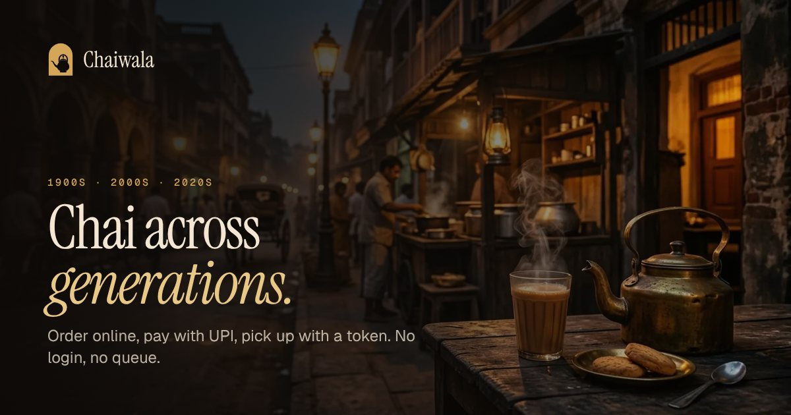
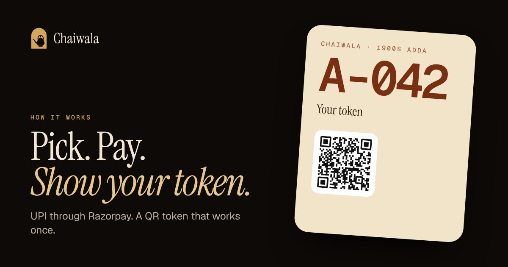
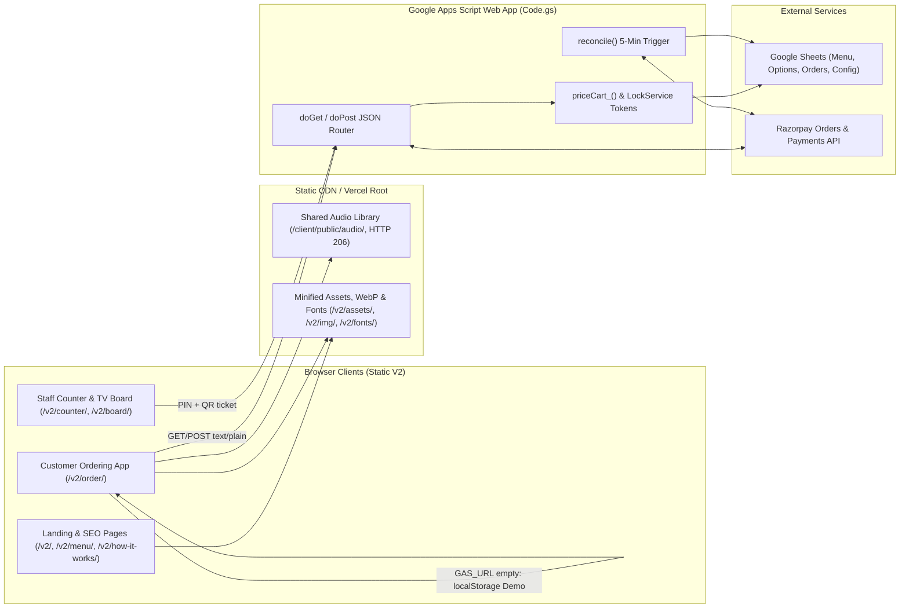

# Chaiwala

**Chai across generations, ordered online.**  
*"Waqt badla. Baithak wahi."* (Time changes. The gathering remains.)

[](v2/)
[](v2/app/)
[](v2/tools/build.py)
[](v2/apps-script/Code.gs)
[](v2/apps-script/Code.gs)
[](vercel.json)

Chaiwala is a three-era chai and café counter ordering platform built to remove peak-hour counter queues without requiring customer logins or a paid backend server. Customers pick drinks across the **1900s Adda**, **2000s Coffee House**, and **2020s Café**, pay via Razorpay, and collect at the counter with a single-use signed QR token.

> **Repository:** [github.com/im-chandanmahapatra/CHAI-WALA](https://github.com/im-chandanmahapatra/CHAI-WALA)  
> **Active Application:** [`v2/`](v2/) (zero-dependency static frontend + Google Apps Script backend). The original React/Supabase prototype is retained in [`client/`](client/) and [`supabase/`](supabase/), while [`client/public/audio/`](client/public/audio/) provides the shared audio library for both versions.

---

## Table of Contents

- [Project Overview](#project-overview)
- [Key Features](#key-features)
- [Screenshots & Preview](#screenshots--preview)
- [Technology Stack](#technology-stack)
- [Project Architecture](#project-architecture)
- [Project Structure](#project-structure)
- [Installation & Local Setup](#installation--local-setup)
- [Environment Variables & Configuration](#environment-variables--configuration)
- [Usage Guide](#usage-guide)
- [API Documentation](#api-documentation)
- [Deployment Guide](#deployment-guide)
- [Development & Contribution](#development--contribution)
- [License & Acknowledgements](#license--acknowledgements)

---

## Project Overview

Traditional chai stalls and campus cafés lose orders and create counter bottlenecks during morning and evening rushes because ordering, payment confirmation, and token calling are manual.

Chaiwala V2 solves this with a lightweight, mobile-first digital counter:

- **What it does:** Lets walk-in customers scan a counter QR or open the web app, customize items from three themed eras, pay in ~30 seconds via UPI/cards/wallets, listen to an era-matched audio deck while waiting, and present a signed QR pass at pickup.
- **Who it is for:** Independent tea stalls, college canteens, boutique cafés, and counter staff who need reliable digital ordering without hosting infrastructure or app installs.
- **Primary objectives:**
  - **Zero login, zero queue:** No sign-up wall; active tokens persist in `localStorage` and can be recovered via mobile number.
  - **Server-authoritative honesty without a VPS:** Google Apps Script + Google Sheets handle menu pricing, Razorpay order creation, HMAC-SHA256 verification, and atomic daily token sequencing.
  - **Offline-friendly demo mode:** When `CONFIG.GAS_URL` is blank, the full customer, counter, and TV board flow runs locally in the browser.

---

## Key Features

### Customer Experience (`/v2/`, `/v2/order/`, `/v2/menu/`, `/v2/how-it-works/`)
- **Three Distinct Eras & Visual Themes:**
  - **1900s · The Adda (`adda`):** Espresso & brass dark palette (`#0E0A07`, `#D4A657`), railway-ticket token pass, `A-` prefixed tokens.
  - **2000s · The Coffee House (`y2k`):** Midnight & aqua-chrome dark palette (`#0A0C11`, `#8FE3DA` / `#C9B2FF`), collage hero, holographic token pass, `Y-` prefixed tokens.
  - **2020s · The Café (`cafe`, "Stone & Matcha"):** Warm stone light palette (`#F4F1EA`, `#3F5F2E`), clean hairline cards, `C-` prefixed tokens.
- **View Transitions Era Switcher:** Circular `document.startViewTransition` reveal between eras with `prefers-reduced-motion` fallbacks.
- **Inline Customization & Cart Dock:** 19 menu items across 6 categories (`chai`, `bites`, `cold`, `coffee`, `tea`, `sweets`) with inline option chips (sweetness, Cutting vs. Kulhad/Regular vs. Large sizing, cheese/boba add-ons), flying-thumbnail animation, and an animated filling cup dock.
- **Deep Linking:** Supports `/v2/order/?era=adda|y2k|cafe` and `/v2/order/?add=<item-id>`.
- **Built-In QR Token Pass & Recovery:** Client-side byte-mode QR SVG encoder (versions 1–6, ECC M — no external QR CDN required), live status polling (`CREATED` → `PAID` → `BREWING` → `READY` → `COLLECTED`), Web Audio ready chime, vibration cues, and phone-number lookup.

### Staff Operations (`/v2/counter/` & `/v2/board/`)
- **PIN-Protected Counter Console (`/v2/counter/`):** 4-digit PIN pad (8 consecutive failures trigger a 5-minute `CacheService` lockout), three live lanes (*New · paid*, *Brewing*, *Ready*), and one-tap order advancement.
- **Single-Use QR Scanner:** Camera-based QR scanning using native `BarcodeDetector` with automatic `jsQR` fallback, plus manual token entry (`A-042`). Subsequent scans of an already-collected ticket flag the exact `collectedAt` timestamp to block screenshot reuse.
- **TV Now-Serving Board (`/v2/board/`):** Auto-refreshing display separating *Preparing* and *Ready to collect* tokens.

### No. 03 Sound System
- **Lazy Playback:** Zero audio bytes download until the user explicitly presses play.
- **Era-Matched Decks:**
  - **1900s Cassette Deck (`WM-1900`):** 90-minute continuous Bollywood tape (`client/public/audio/90s_playlist.mp3`) split into 15 timestamped chapters with HTTP `206 Partial Content` seeking.
  - **2000s Discman (`CD-2000`):** 12 tracks (years ≤ 2015) from `client/public/audio/2000s-manifest.json` with LCD track/timer readout.
  - **2020s Turntable:** 23 tracks (years > 2015) from `client/public/audio/2000s-manifest.json` with track aura theming.

### Payment Integrity & SEO
- **Server-Side Pricing & Settlement:** `priceCart_()` recomputes all totals from the `Menu` and `Options` sheets; `verifyPayment_()` checks Razorpay's HMAC-SHA256 signature against the `rzpOrderId` stored in the `Orders` sheet and calls `ensureCaptured_()` if auto-capture is off.
- **5-Minute Reconciliation:** A time-driven trigger runs `reconcile()` every 5 minutes (plus on-reopen checks in `status_()`) to recover payments if a customer closes the tab before client verification completes.
- **SEO & Static Generation:** `v2/tools/build.py` generates clean-URL HTML pages with per-page canonicals, Open Graph/Twitter tags, JSON-LD (`WebSite`, `CafeOrCoffeeShop`, `Menu`, `FAQPage`, `BreadcrumbList`), `sitemap.xml`, `robots.txt`, `llms.txt`, `site.webmanifest`, and root `404.html`.

---

## Screenshots & Preview

### V2 Social & Brand Preview Assets

| Landing (`/v2/`) | Menu (`/v2/menu/`) | How It Works (`/v2/how-it-works/`) |
| :---: | :---: | :---: |
|  |  |  |

### Live V2 Application Screenshots

> [!NOTE]
> Screenshots currently stored in [`artifacts/screenshots/`](artifacts/screenshots/) and [`screenshots/`](screenshots/) capture the **V1** React prototype (`client/`). Live V2 browser captures can be added below as they are recorded:
>
> | View | Route | Status / Suggested Filename |
> |---|---|---|
> | Editorial Landing Page | `/v2/` | *Pending capture* (`v2/screenshots/landing.png`) |
> | 3-Era Ordering & Sound System | `/v2/order/` | *Pending capture* (`v2/screenshots/order-eras.png`) |
> | Signed QR Token Pass | `/v2/order/` | *Pending capture* (`v2/screenshots/token-pass.png`) |
> | Staff Counter & QR Scanner | `/v2/counter/` | *Pending capture* (`v2/screenshots/counter.png`) |

---

## Technology Stack

### V2 Active Stack

| Layer | Technology | Details |
|---|---|---|
| **Frontend** | HTML5, CSS3, Vanilla JS (`ES2020`) | Zero runtime dependencies; [`v2/app/app.js`](v2/app/app.js), [`v2/app/landing.js`](v2/app/landing.js), [`v2/app/app.css`](v2/app/app.css) |
| **Typography & Media** | Self-hosted WOFF2, WebP, SVG | `Geist`, `Geist Mono`, `Instrument Serif` in [`v2/fonts/`](v2/fonts/); 1.1 MB WebP assets in [`v2/img/`](v2/img/); outlined brand SVGs in [`v2/brand/`](v2/brand/) |
| **Build & Tooling** | Python 3, `esbuild` (optional) | [`v2/tools/build.py`](v2/tools/build.py) + [`v2/tools/pages_landing.py`](v2/tools/pages_landing.py) generate HTML/SEO and minify CSS/JS into [`v2/assets/`](v2/assets/) |
| **Backend & Database** | Google Apps Script (V8) + Google Sheets | [`v2/apps-script/Code.gs`](v2/apps-script/Code.gs) with `Menu`, `Options`, `Orders`, and `Config` sheets, `LockService`, and `CacheService` |
| **Payments & Auth** | Razorpay Checkout + HMAC-SHA256 | Server-side Razorpay REST API v1; HMAC-SHA256 signed QR tickets (`TOKEN_SECRET`); PIN-locked counter endpoints (`COUNTER_PIN`) |
| **Audio Assets** | HTML5 `Audio`, HTTP `206` Range | Shared library in [`client/public/audio/`](client/public/audio/) (`90s_playlist.mp3` + 35 tracks in `2000s/`) |
| **Hosting & Local Dev** | Vercel Static, Python `http.server` | [`vercel.json`](vercel.json) + [`.vercelignore`](.vercelignore); local range-capable server [`v2/serve.py`](v2/serve.py) |

### V1 Legacy Stack (Retained in `client/` & `supabase/`)

| Component | Technologies |
|---|---|
| **Frontend (`client/`)** | React `19.0.0`, TypeScript `5.7.3`, Vite `6.1.0`, `@supabase/supabase-js` `2.48.1`, `lucide-react` `0.475.0` |
| **Database (`supabase/`)** | PostgreSQL 15+ schema (`14` tables), RLS policies, atomic `create_order` & `transition_order_status` RPCs |
| **Tests (`tests/`)** | Python Playwright (`tests/test_music_integration.py`) + Node QA scripts (`client/.qa-order-tests.mjs`, `client/verify-ui.mjs`) |

---

## Project Architecture



---

## Project Structure

```text
CHAI/
├── vercel.json                     # Vercel static routing: / -> /v2/, trailingSlash, security/cache headers
├── .vercelignore                   # Excludes local tools, reports, node_modules, and build caches from deploy
├── .gitignore                      # Ignores node_modules, dist, .env*, local media scratch dirs, __pycache__
├── 404.html                        # Root custom 404 page (auto-generated by v2/tools/build.py)
├── favicon.ico                     # Root site favicon
├── llms.txt                        # LLM-readable menu and site index
├── robots.txt                      # Crawl rules (disallows /v2/counter/ and /v2/board/)
├── README.md                       # Root project documentation (this file)
│
├── v2/                             # Active V2 application (see v2/README.md)
│   ├── app/                        # Unminified source: app.js, app.css, landing.js
│   ├── assets/                     # Minified runtime bundles output by build.py
│   ├── apps-script/                # Google Apps Script backend (Code.gs, appsscript.json, README.md)
│   ├── brand/                      # Outlined SVG logo lockups, marks, and app icon
│   ├── fonts/                      # Self-hosted Geist, Geist Mono, Instrument Serif WOFF2 + fonts.css
│   ├── icons/                      # SVG and PNG favicons / PWA icons
│   ├── img/                        # Optimized WebP menu & scene images + token-qr.svg
│   ├── og/                         # 1200x630 Open Graph / Twitter social cards
│   ├── tools/                      # Static HTML/SEO generator (build.py, pages_landing.py)
│   ├── index.html                  # Generated landing page (/v2/)
│   ├── order/index.html            # Generated ordering counter (/v2/order/)
│   ├── menu/index.html             # Generated full menu page (/v2/menu/)
│   ├── how-it-works/index.html     # Generated FAQ & workflow page (/v2/how-it-works/)
│   ├── counter/index.html          # Generated staff counter console (/v2/counter/)
│   ├── board/index.html            # Generated TV now-serving board (/v2/board/)
│   ├── serve.py                    # Local HTTP server with Range 206 audio seeking + custom 404
│   ├── DESIGN.md                   # Three-era design tokens, typography, and logo rules
│   ├── README.md                   # V2 frontend & build documentation
│   ├── site.webmanifest            # Web app manifest
│   └── sitemap.xml                 # Generated XML sitemap
│
├── client/                         # V1 legacy React + Vite app & shared audio assets (see client/README.md)
│   ├── public/audio/               # Shared audio: 90s_playlist.mp3, 2000s/ (35 MP3s), 2000s-manifest.json
│   └── src/                        # V1 React 19 + TypeScript components and Supabase client
│
├── supabase/                       # V1 PostgreSQL schema & RLS migration (see supabase/README.md)
├── tests/                          # V1 Playwright audio test suite (see tests/README.md)
├── docs/                           # Architecture, development guides, and academic presentation assets
├── scripts/                        # Python report/diagram/presentation generators
└── artifacts/ & screenshots/       # V1 test evidence and visual captures
```

---

## Installation & Local Setup

### Prerequisites
- **Python 3.10+** (required for `v2/serve.py` and `v2/tools/build.py`)
- **Node.js 18+ / npm** *(optional — only needed if minifying V2 JS/CSS with `esbuild` or running the V1 app in `client/`)*

### 1. Clone the Repository

```powershell
git clone https://github.com/im-chandanmahapatra/CHAI-WALA.git
cd CHAI-WALA
```

### 2. Run V2 Locally (Demo Mode — No Setup Required)

```powershell
python v2/serve.py
```

By default `serve.py` listens on port `8080` (pass a custom port as `python v2/serve.py 3000`). It serves the repo root with `Accept-Ranges: bytes` (`206 Partial Content`) so seeking inside the 90-minute cassette recording works locally.

Open:
- **Landing page:** `http://localhost:8080/v2/`
- **Customer ordering:** `http://localhost:8080/v2/order/`
- **Staff counter mode:** `http://localhost:8080/v2/counter/` (demo PIN: **`2580`**)
- **Now-serving TV board:** `http://localhost:8080/v2/board/`

### 3. Rebuild Static Pages & Minified Assets After Editing `v2/app/*`

```powershell
python v2/tools/build.py
```

This regenerates all six HTML pages (`v2/index.html`, `order/`, `menu/`, `how-it-works/`, `counter/`, `board/`), `404.html`, `v2/sitemap.xml`, `robots.txt`, `llms.txt`, `v2/llms.txt`, and `v2/site.webmanifest`. If `esbuild` is installed at `v2/node_modules/.bin/esbuild` or on `PATH`, it minifies `v2/app/{app.js,app.css,landing.js}` into `v2/assets/`; otherwise it copies them unminified.

### 4. Run V1 Legacy Client *(Optional)*

```powershell
cd client
npm install
npm run dev      # http://localhost:5173/
npm run build    # outputs to client/dist/
```

---

## Environment Variables & Configuration

V2 uses **zero `.env` files on the frontend**; client settings live in source config, and all secrets live in **Google Apps Script Properties** (never committed to Git).

### V2 Frontend Configuration ([`v2/app/app.js`](v2/app/app.js#L5-L8) & [`v2/tools/build.py`](v2/tools/build.py#L17-L29))

| Setting | File | Required | Default / Behavior |
|---|---|---|---|
| `CONFIG.GAS_URL` | `v2/app/app.js` | Optional | `''` — When empty, runs in browser `localStorage` **Demo Mode** (`Demo` adapter + simulated payment). Set to your Apps Script `/exec` URL to go live. |
| `CONFIG.DEMO_PIN` | `v2/app/app.js` | Optional | `'2580'` — Used only in Demo Mode (`DEMO === true`); ignored when `GAS_URL` is configured. |
| `SITE_URL` | `v2/tools/build.py` | Optional | Canonical base URL used for `<link rel="canonical">`, Open Graph, JSON-LD, `sitemap.xml`, and `robots.txt`. |
| `BUSINESS` | `v2/tools/build.py` | Optional | Store address, phone, opening hours, and coordinates for `CafeOrCoffeeShop` JSON-LD (blank keys are omitted). |

### V2 Backend Script Properties (Google Apps Script → Project Settings → Script properties)

| Property | Required | Description |
|---|---|---|
| `RZP_KEY_ID` | Mandatory (Live) | Razorpay Key ID (`rzp_test_...` or `rzp_live_...`). Returned to Checkout by `createOrder_()`. |
| `RZP_KEY_SECRET` | Mandatory (Live) | Razorpay Key Secret. Used server-side for Razorpay REST auth and HMAC-SHA256 payment verification. Never exposed to the browser. |
| `TOKEN_SECRET` | Mandatory (Live) | High-entropy random string used to sign QR ticket payloads (`<orderId>.<16-hex-hmac>`). |
| `COUNTER_PIN` | Mandatory (Live) | 4–6 digit staff PIN required for all `counter.*` POST endpoints. |

### V1 Legacy Environment Variables (`client/.env.example`)

| Variable | Required | Description |
|---|---|---|
| `VITE_SUPABASE_URL` | Optional | Supabase project URL for V1 (`client/`). When unset, V1 falls back to a local mock adapter. |
| `VITE_SUPABASE_ANON_KEY` | Optional | Supabase anonymous public key for V1 (`client/`). Never place service-role or payment secrets in `VITE_*` variables. |

---

## Usage Guide

1. **Browse & Select an Era:** Open `/v2/` to explore the three eras, full menu (`/v2/menu/`), or token FAQ (`/v2/how-it-works/`). Click **Start an order** to enter `/v2/order/`.
2. **Customize & Add Items:** Switch between `1900s`, `2000s`, and `2020s` via the top pill or era banner. Tap any menu card to expand sweetness, cup size, or add-on options in place and add it to the dock.
3. **Checkout & Token Issuance:** Tap the floating cup dock to open the order sheet, view the live queue wait-time estimate, enter your call-out name and 10-digit Indian mobile number (`[6-9]\d{9}`), and slide to pay.
4. **Track & Collect:** After verification, a signed QR token pass (`A-001`, `Y-001`, or `C-001`) opens and persists on the device for the current day. Use **Find my token** in the footer to recover tokens by phone number.
5. **Counter Operations (`/v2/counter/` & `/v2/board/`):** Staff sign in with the counter PIN, advance orders through `PAID` → `BREWING` → `READY`, or open **Scan** to scan a customer's QR pass (or type the token code) and mark it `COLLECTED`. Open `/v2/board/` in fullscreen on a counter display.

---

## API Documentation

The V2 backend is implemented in [`v2/apps-script/Code.gs`](v2/apps-script/Code.gs) as a Google Apps Script Web App (`Execute as: Me`, `Access: Anyone`).

- **Base URL:** `CONFIG.GAS_URL` (`https://script.google.com/macros/s/<DEPLOYMENT_ID>/exec`)
- **POST Content-Type:** Requests send `Content-Type: text/plain;charset=utf-8` with a JSON string body so browsers skip CORS preflight `OPTIONS` requests that Apps Script cannot answer.
- **Response Envelope:** Every endpoint returns JSON `{ "ok": true, ... }` on success or `{ "ok": false, "error": "<message>" }` on failure.

### `GET` Endpoints (`doGet`)

| Action (`?action=...`) | Query Parameters | Auth | Description & Key Response Fields |
|---|---|---|---|
| *(default / omitted)* | — | Public | Health check: `{ ok, service: "chaiwala-v2", time }` |
| `menu` | — | Public | Cached (60s) menu & option groups from Sheets: `{ ok, items, groups }` |
| `queue` | — | Public | Active `PAID` + `BREWING` count & wait estimate: `{ ok, ahead, eta }` |
| `status` | `ticket` (`<orderId>.<hmac16>`) | Signed ticket | Order status + queue position (triggers rate-limited Razorpay check if still `CREATED`): `{ ok, orderId, ticket, token, status, era, name, items, amount, eta, ahead, paidAt, readyAt, collectedAt }` |
| `lookup` | `phone` (10 digits) | Public | Today's paid tokens matching phone: `{ ok, orders: [{ token, status, ticket }] }` |
| `board` | — | Public | Today's tokens for TV display: `{ ok, brewing: [...], ready: [...] }` |

### `POST` Endpoints (`doPost`)

| Action (`body.action`) | Required Body Fields | Auth | Description |
|---|---|---|---|
| `create` | `era`, `name`, `phone`, `items: [{ id, qty, opts }]` | Public | Re-prices cart from `Menu`/`Options` sheets, creates Razorpay order, inserts `CREATED` row, returns `{ ok, orderId, ticket, rzpOrderId, amount, keyId, lines }` |
| `verify` | `orderId`, `razorpay_payment_id`, `razorpay_signature` | HMAC-SHA256 | Verifies `HMAC_SHA256(sheet.rzpOrderId + "|" + payment_id, RZP_KEY_SECRET)`, captures if `authorized`, assigns locked daily token, returns order view |
| `counter.list` | `pin` | `COUNTER_PIN` | Lists today's tokenized orders and queue stats (`{ ok, orders, queue }`) |
| `counter.advance` | `pin`, `orderId`, `to` (`BREWING` \| `READY` \| `COLLECTED`) | `COUNTER_PIN` | Advances strict state transition `PAID → BREWING → READY → COLLECTED` |
| `counter.collect` | `pin`, `ticket` (`<orderId>.<hmac16>`) | `COUNTER_PIN` | Verifies signed QR ticket and marks `COLLECTED` (returns `{ ..., already: true }` if previously scanned) |
| `counter.collectToken` | `pin`, `token` (e.g. `A-042`) | `COUNTER_PIN` | Manual counter fallback to mark today's token `COLLECTED` |

> See [`v2/apps-script/README.md`](v2/apps-script/README.md) for complete Google Sheets tab schemas, example JSON payloads, and security details.

---

## Deployment Guide

### 1. Deploy V2 Frontend on Vercel

The repository root includes [`vercel.json`](vercel.json) and [`.vercelignore`](.vercelignore) configured for static hosting of V2 alongside the shared audio assets in `client/public/audio/`.

- **GitHub Integration:** Connected to `im-chandanmahapatra/CHAI-WALA`
- **Production Branch:** `main`
- **Vercel Dashboard Settings (`Project Settings → Build & Deployment`):**
  - **Root Directory:** *(leave blank / `.` — repository root, **not** `client` or `v2`)*
  - **Framework Preset:** `Other`
  - **Build Command / Output Directory overrides:** Disabled (controlled by [`vercel.json`](vercel.json): `"framework": null`, `"buildCommand": null`, `"outputDirectory": "."`)
- **Routing Behavior (`vercel.json`):**
  - `/` redirects to `/v2/`
  - `trailingSlash: true` normalizes `/v2`, `/v2/order`, `/v2/menu`, `/v2/how-it-works`, `/v2/counter`, and `/v2/board`
  - `/v2/counter/*` and `/v2/board/*` send `X-Robots-Tag: noindex, nofollow`
  - `/client/public/audio/*` serves with `Cache-Control: public, max-age=31536000, immutable` and native HTTP `206` byte-range support
- **Verification after deploying:** Check `/`, `/v2/`, `/v2/order/`, `/v2/menu/`, `/v2/how-it-works/`, `/v2/counter/`, `/v2/board/`, `/client/public/audio/2000s-manifest.json`, and byte-range playback on `/client/public/audio/90s_playlist.mp3`.

### 2. Deploy V2 Backend (Google Apps Script + Razorpay)

1. Create a Google Sheet and open **Extensions → Apps Script**.
2. Copy [`v2/apps-script/Code.gs`](v2/apps-script/Code.gs) and [`v2/apps-script/appsscript.json`](v2/apps-script/appsscript.json).
3. In **Project Settings → Script properties**, add `RZP_KEY_ID`, `RZP_KEY_SECRET`, `TOKEN_SECRET`, and `COUNTER_PIN`.
4. Run `setup()` once in the Apps Script editor to initialize the `Menu`, `Options`, `Orders`, and `Config` sheets plus the 5-minute `reconcile` trigger.
5. Deploy via **Deploy → New deployment → Web app** (`Execute as: Me`, `Who has access: Anyone`).
6. Set `CONFIG.GAS_URL` in [`v2/app/app.js`](v2/app/app.js#L6) to the `/exec` URL, run `python v2/tools/build.py`, and commit/push the updated bundle.

### 3. Alternative Static Hosting (GitHub Pages)

Update `SITE_URL` in [`v2/tools/build.py`](v2/tools/build.py#L17) if deploying under a subpath (defaults to `https://im-chandanmahapatra.github.io/CHAI-WALA/v2/`), run `python v2/tools/build.py`, and enable **GitHub Pages → Deploy from branch (`main`, `/root`)**.

---

## Development & Contribution

- **Primary Branch:** `main`
- **Workflow:**
  1. Edit V2 source files in [`v2/app/`](v2/app/) (`app.js`, `app.css`, `landing.js`) or templates in [`v2/tools/`](v2/tools/) rather than editing generated HTML or `v2/assets/*` directly.
  2. Run `python v2/tools/build.py` to regenerate all HTML pages, minified assets, and SEO files.
  3. Test all routes and HTTP `206` audio seeking locally using `python v2/serve.py`.
  4. Never commit `.env`, `.env.local`, API secrets, `node_modules/`, or `__pycache__/`.
- **Commit Convention:** Conventional prefixes such as `feat(v2):`, `fix(vercel):`, `chore(vercel):`, `docs:`.
- **Pull Requests:** Keep changes scoped, preserve existing comments/docstrings, and verify generated outputs match source edits before pushing.

---

## License & Acknowledgements

- **License:** No repository-level `LICENSE` file has been established in the root directory. *(Note: any third-party license files inside local scratch/package archives apply only to those respective dependencies.)*
- **Acknowledgements:**
  - Typography uses self-hosted open-source **Geist**, **Geist Mono**, and **Instrument Serif** fonts (`v2/fonts/`).
  - Payment processing integration targets **Razorpay** (`checkout.razorpay.com` and REST API v1).
  - Serverless sheet persistence runs on **Google Apps Script** and **Google Sheets**.
